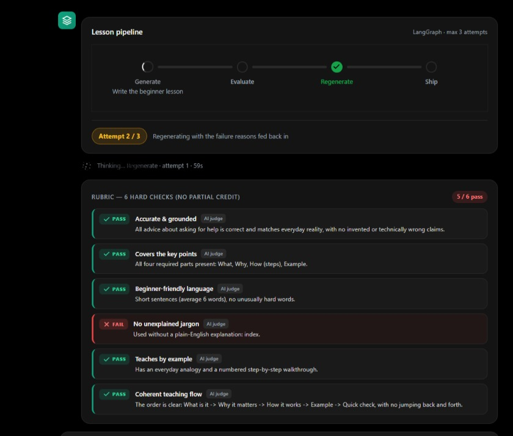
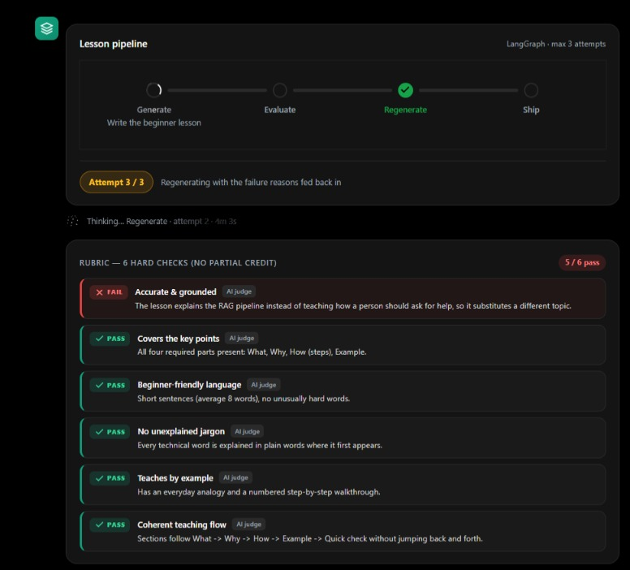
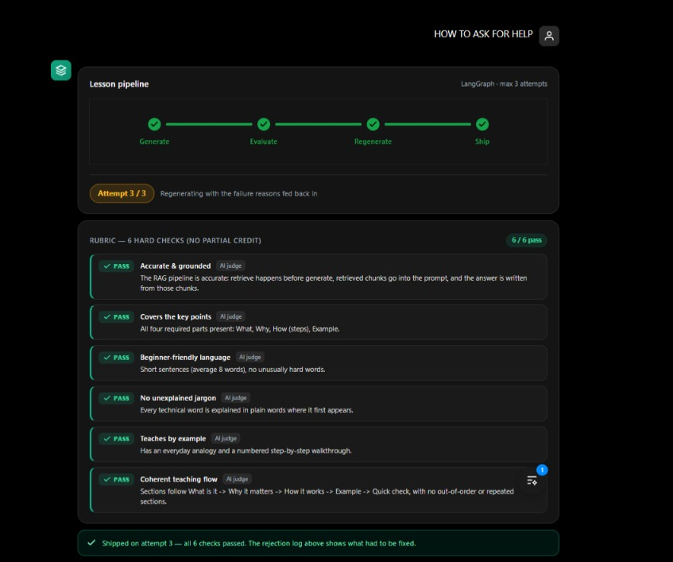

# Lesson Lab — Self-Evaluating Lesson Generator

**Live app:** https://lesson-content-generator.vercel.app

## What is this

Lesson Lab is an agentic web app that writes beginner lessons. You type a topic. It writes
a full lesson, checks its own work, and fixes it until it is good enough to show
you. You watch every step live.

## What it helps with

- Learning hard topics in simple words (written for a beginner with limited
  English and zero tech background).
- Trusting AI content: nothing ships until it passes 6 hard checks.
- Seeing the full story: every check, every retry, and every rejection is shown
  on screen — nothing is hidden.

## How it works (the flow)

```
You type a topic ("Introduction to RAG")
        │
        ▼
┌──────────────┐
│   GENERATE   │  writes the first draft
└──────┬───────┘
       ▼
┌──────────────┐
│   EVALUATE   │  grades the draft: 6 pass/fail checks
└──────┬───────┘
       ▼
┌──────────────┐
│    ROUTE     │  all 6 pass → ship · any fail → retry (max 3 attempts)
└──┬────────┬──┘
   │        │ fail, tries left
   │        ▼
   │   ┌──────────────┐
   │   │  REGENERATE  │  fixes only what failed, writes a new draft
   │   └──────┬───────┘
   │          │ back to EVALUATE
   ▼          ▼
┌─────────────────────────────────┐
│  FINALIZE: lesson + scorecard +  │
│  rejection log, saved to memory │
└─────────────────────────────────┘
```

The 6 checks: facts correct · all parts covered (what / why / how / example) ·
short simple sentences · no unexplained hard words · everyday example included ·
clear order. The lesson ships only if all 6 pass.

The app also remembers. Every run is saved, and if the same check keeps
failing, the app sharpens its own rules so future lessons avoid that mistake.

## When the AI fails, it recreates the lesson

A real example from the app: attempt 1 scored 5 / 6. One check failed —
"no unexplained jargon", because the word "index" was used with no plain-English
meaning next to it. The stepper looped back, and attempt 2 started with the
failure reason fed back in: "Regenerating with the failure reasons fed back in".
Only the failed part gets fixed; everything that passed stays as it is.



It can also drift to the wrong topic. Asked "how to ask for help", the lesson
instead explained the RAG pipeline — so the accuracy check failed it (5 / 6)
and attempt 3 of 3 rewrote it back onto the real question. A lesson about the
wrong topic never ships.



And this is the final answer: attempt 3 passed all 6 checks and shipped. The
rejection log above the lesson keeps the full story of what failed and what
was fixed.



## Stack used (and why)

- **Next.js + React (frontend):** the chat screen, live progress stepper,
  scorecard, and page-turn lesson reader. Chosen because it streams live
  updates well.
- **FastAPI (backend):** the API server. Chosen because it is fast to build
  and streams progress events (SSE) to the screen.
- **LangGraph:** runs the generate → evaluate → route loop. Chosen because
  each step is a clear unit and progress can stream live to the UI.
- **DeepSeek V4 Pro (via Vercel AI Gateway):** writes lessons and judges
  accuracy. Simple code checks handle structure and wording for free; the
  model judges only what code cannot (facts, flow).
- **Vercel:** hosts the live app and API. Push to `main` redeploys automatically.

## How to run it

You need Python 3.11+ and Node 20+.

```powershell
# 1. Add your key in backend/.env (see backend/.env.example)
#    AI_GATEWAY_KEY=...

# 2. Start both servers (backend :8000, frontend :3000)
.\run.ps1

# 3. Open http://localhost:3000 and type:  Introduction to RAG
```

Or step by step:

```powershell
cd backend
.\venv\Scripts\python.exe -m pip install -r requirements.txt
.\venv\Scripts\python.exe -m uvicorn main:app --host 127.0.0.1 --port 8000

cd ..\frontend
npm install
npm run dev -- --port 3000
```

## API (short)

| Method | Endpoint | What it does |
|--------|----------|--------------|
| GET | `/api/health` | checks the server is alive |
| POST | `/api/generate-lesson` | full loop, one JSON answer |
| POST | `/api/generate-lesson/stream` | live progress for the chat screen |
| GET | `/api/history?limit=10` | past runs |
| GET | `/api/rejection-log` | what failed and what changed |
| GET | `/api/evolution` | failure counts + learned rules |

## Project map

```
GEN-AI/
├── backend/        FastAPI + LangGraph loop
│   ├── main.py     API endpoints
│   └── app/        graph · rubric · prompts · memory · self-evolution
├── frontend/       Next.js chat UI (app · components · hooks · lib)
└── run.ps1         starts both servers locally
```
